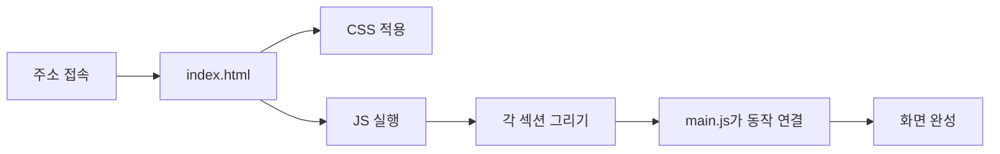

# eleFolio — Product Designer Portfolio

HTML, CSS, Vanilla JavaScript로 만든 프로덕트 디자이너 원페이지 포트폴리오입니다.  
빌드 도구 없이 브라우저에서 바로 열 수 있습니다.

**운영 사이트:** 
[vibe-coding-portfolio-xi-two.vercel.app](https://vibe-coding-portfolio-xi-two.vercel.app/)


## 소개

**eleFolio**는 프리랜스 프로덕트 디자이너(SEOKBEOM_OH)를 소개하는 랜딩 페이지입니다.  
한 화면을 스크롤하며 아래 내용을 차례로 보여 줍니다.

- 브랜드 소개와 CTA(Contact / Download CV)
- 제공 서비스(User Research, Visual Design, User Testing, Prototyping)
- 프로젝트 미리보기(브라우저 UI 모티브)
- 스킬 영역(Brand Identity, Product Design, Interaction Design, App Design)

`index.html`에는 섹션이 들어갈 빈 자리만 있습니다.  
각 섹션의 글과 마크업은 JavaScript가 그리고, 모양은 섹션마다 나뉜 CSS가 담당합니다.

페이지에서 바로 보이는 동작은 다음과 같습니다.

- 반응형 네비게이션 (데스크톱 메뉴 / 모바일 햄버거)
- Hero, About, Portfolio, Skills 섹션
- 스크롤하면 섹션이 나타나는 애니메이션 (Intersection Observer)
- 서비스 카드에 마우스를 올리면 살짝 떠오르는 효과
- CSS 변수로 맞춘 테마 컬러
- 모바일부터 데스크톱까지 이어지는 반응형 레이아웃


## 기술 스택

서버 언어나 프레임워크는 쓰지 않습니다.  
브라우저가 HTML, CSS, JavaScript를 직접 읽습니다.

| 구분 | 기술 | 하는 일 |
|------|------|---------|
| 마크업 | HTML5 | `index.html`이 페이지의 시작점입니다. 섹션이 들어갈 빈 `div`만 둡니다. |
| 스타일 | CSS3 | 파일마다 역할을 나누고, 색·그림자는 CSS 변수로 맞춥니다. |
| 스크립트 | Vanilla JavaScript | 섹션 내용을 그리고, 호버와 스크롤 애니메이션을 연결합니다. |
| 글꼴 | Google Fonts (Poppins) | CDN으로 불러옵니다. |
| 아이콘 | Font Awesome 6 | CDN으로 불러옵니다. |
| 로컬 확인 | Live Server | Cursor에서 이 폴더를 `http://127.0.0.1:5501/` 로 엽니다. |
| 운영 배포 | Vercel | 빌드 없이 정적 파일 그대로 공개합니다. |

`npm install` 이나 빌드 명령은 없습니다.


## 프로젝트 구조

```
1-html-css-js-demo/
├── index.html              # 브라우저가 가장 먼저 읽는 파일
├── README.md
├── .vscode/settings.json   # Live Server 포트 5501
├── css/
│   ├── reset.css           # 브라우저 기본 스타일 정리
│   ├── variables.css       # 컬러, 그림자, 레이아웃 토큰
│   ├── layout.css          # 공통 레이아웃
│   ├── navbar.css
│   ├── hero.css
│   ├── about.css
│   ├── portfolio.css
│   ├── skills.css
│   ├── services.css        # 파일은 있으나 index.html에 연결되지 않음
│   └── responsive.css      # 화면 너비에 따른 배치
└── js/
    ├── navbar.js           # 네비게이션을 그려 넣음
    ├── hero.js
    ├── about.js
    ├── portfolio.js
    ├── skills.js
    ├── services.js         # 파일은 있으나 index.html에 연결되지 않음
    └── main.js             # 그린 뒤의 호버, 스크롤 애니메이션
```

주소로 접속하면 브라우저가 `index.html`을 읽고, CSS로 모양을 입힌 다음 JavaScript가 빈 칸을 채웁니다.



```
주소 → index.html
        ├─ CSS : 스타일 입히기
        └─ JS
             1) navbar / hero / about / portfolio / skills
                → 빈 div 안에 각 섹션 내용 넣기
             2) main.js
                → 카드 호버, 스크롤 애니메이션 연결
```

- `render`로 시작하는 함수는 화면에 섹션을 그립니다.
- `main.js`는 그린 뒤에 움직임을 붙입니다.
- DOM은 브라우저가 기억하는 페이지 구조입니다. 스크립트는 이 구조의 빈 자리에 내용을 넣습니다.

| 섹션 | 파일 | 역할 |
|------|------|------|
| Navbar | `js/navbar.js`, `css/navbar.css` | 로고, 메뉴, 모바일 햄버거. 스크롤하면 막대 스타일이 바뀝니다. |
| Hero | `js/hero.js`, `css/hero.css` | 타이틀, 소개 문구, Contact / Download CV 버튼 |
| About | `js/about.js`, `css/about.css` | 서비스 카드 4개와 About Me 소개 |
| Portfolio | `js/portfolio.js`, `css/portfolio.css` | 브라우저 창 모양의 프로젝트 미리보기 |
| Skills | `js/skills.js`, `css/skills.css` | 제공할 수 있는 작업 범위를 카드로 보여 줌 |

`services.js`와 `services.css`는 폴더에 들어 있지만 `index.html`에는 연결되어 있지 않습니다.  
서비스 소개는 About 섹션의 카드가 맡고 있습니다.


## 실행 방법

페이지를 보는 곳은 두 군데입니다. 내 PC와, 인터넷에 올려 둔 운영 사이트입니다.  
둘 다 별도의 서버 프로그램을 설치하지 않습니다.


### 로컬

Cursor에서 `index.html`을 연 것은 코드를 읽는 일입니다.  
웹 페이지를 보려면 이 폴더를 작은 웹 서버로 연 뒤, 브라우저로 그 주소에 접속합니다.

브라우저에 입력하는 주소는 아래입니다.

http://127.0.0.1:5501/

`http://localhost:5501/` 도 같은 곳입니다.  
이 주소는 내 컴퓨터의 5501번 포트에서 파일을 내려주는 서버를 가리킵니다.  
그 서버를 켜는 메뉴가 **Open with Live Server**입니다.  
이 메뉴를 실행하기 전에는 위 주소를 열어도 페이지가 나오지 않습니다.

순서:

1. Cursor에서 이 프로젝트 폴더 `1-html-css-js-demo`를 엽니다.
2. `index.html`을 엽니다.
3. 편집기에서 우클릭한 뒤 **Open with Live Server**를 실행합니다.
4. 브라우저가 `http://127.0.0.1:5501/` 로 열립니다. 자동으로 안 열리면 주소창에 직접 입력합니다.

포트 번호는 `.vscode/settings.json`에 적혀 있습니다.

```json
{ "liveServer.settings.port": 5501 }
```

Live Server를 끄면 위 주소는 더 이상 열리지 않습니다. 다시 보려면 같은 메뉴를 한 번 더 실행합니다.  
파일을 수정하고 저장하면 Live Server가 브라우저를 새로고침합니다.

이 폴더를 Cursor의 작업 폴더로 연 상태에서 켜야 주소가 `http://127.0.0.1:5501/` 입니다.  
더 위 폴더를 작업 폴더로 연 채 켜면, 포트가 `5500`이 되고 주소 끝에 `/1-html-css-js-demo/` 가 붙을 수 있습니다.

PC에 코드가 없으면 저장소를 받은 뒤 이 폴더로 이동합니다.

```bash
git clone https://github.com/SEOKBEOM-OH/vibe-coding-portfolio.git
cd vibe-coding-portfolio/1-html-css-js-demo
```


### 운영

브라우저 주소창에 아래를 입력합니다.

https://vibe-coding-portfolio-xi-two.vercel.app/

이 페이지는 HTML, CSS, JavaScript 파일만 있는 정적 사이트입니다.  
Vercel에 배포해 두면 Vercel이 그 파일을 계속 보여 줍니다.  
대시보드에서 서버를 시작하거나 Start 버튼을 누르지 않아도 됩니다. 주소만 열면 됩니다.

주소를 잊어버렸으면 Vercel에서 이 프로젝트를 다시 찾습니다.

1. [vercel.com](https://vercel.com)에 로그인합니다.
2. 예전에 올려 둔 이 프로젝트를 클릭합니다.
3. 화면에 나온 `*.vercel.app` 주소로 접속합니다.

2026-10-28에 확인한 주소가 위의 링크입니다.  
새로 배포하면 주소가 바뀔 수 있습니다. 바뀌면 이 README 맨 위의 주소도 함께 고칩니다.

예전 주소 `https://vibe-coding-portfolio-rouge.vercel.app/` 는 그 배포가 Vercel에서 사라져 열리지 않습니다.  
접속하면 `DEPLOYMENT_NOT_FOUND`(배포를 찾을 수 없음)가 나옵니다.

대시보드에서도 프로젝트가 없으면 같은 주소를 되살릴 수 없습니다. 아래 순서로 다시 배포합니다.

1. Vercel에서 **Add New → Project**를 누릅니다.
2. GitHub 저장소 `SEOKBEOM-OH/vibe-coding-portfolio`를 가져옵니다.
3. **Root Directory**를 `1-html-css-js-demo`로 지정합니다. `index.html`이 이 폴더에 있습니다.
4. Framework는 **Other**로 두고, Build Command는 비워 둡니다.
5. **Deploy**를 누릅니다.


## 참고

- Google Fonts와 Font Awesome은 인터넷에 연결된 상태에서 CDN으로 불러옵니다.
- 이미지 자리는 플레이스홀더입니다. 실제 프로필 사진과 프로젝트 이미지로 바꿀 수 있습니다.
- Contact와 Download CV는 데모용 링크입니다. 실제 연락처와 이력서 주소로 연결하면 됩니다.


## 라이선스

Personal / learning project.
